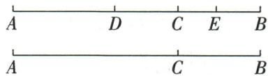

<!-- question-source:start -->
2[2025重庆沙坪坝区质检,中]如图,已知点C在线段AB上,且AC=2BC,线段DE在线段AB上运动(点D,E不与点A,B重合,且点D在点E的左侧),AB=15,DE=6.
(1) 当点 E 为 BC 的三等分点时, 求线段 AD 的长;
(2) 点 F 在线段 AB 上(不与点 A, B, C 重合), 且 AF = 3AD, CF = 3, 求线段 AE 的长.

建议用时-30分钟 答案-D59

备用图
<!-- question-source:end -->

![[Q00100749A1]]
