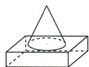
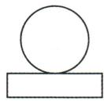
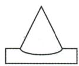
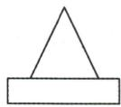
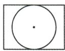

## 6.2.1 直线、射线、线段

  
( )

A

B

C

D

![[初中/课堂同步/教辅/必刷题/2026版《初中必刷题》数学 RJ  7上/06_第六章_几何图形初步/6_2_1_直线_射线_线段/questions/Q00097294.md]]
![[初中/课堂同步/教辅/必刷题/2026版《初中必刷题》数学 RJ  7上/06_第六章_几何图形初步/6_2_1_直线_射线_线段/questions/Q00097295.md]]
## 知识点 2 根据从不同方向看到的图形还原物体

![[初中/课堂同步/教辅/必刷题/2026版《初中必刷题》数学 RJ  7上/06_第六章_几何图形初步/6_2_1_直线_射线_线段/questions/Q00097296.md]]
![[初中/课堂同步/教辅/必刷题/2026版《初中必刷题》数学 RJ  7上/06_第六章_几何图形初步/6_2_1_直线_射线_线段/questions/Q00097297.md]]
![[初中/课堂同步/教辅/必刷题/2026版《初中必刷题》数学 RJ  7上/06_第六章_几何图形初步/6_2_1_直线_射线_线段/questions/Q00097298.md]]
## 知识点 3 立体图形的展开图

![[初中/课堂同步/教辅/必刷题/2026版《初中必刷题》数学 RJ  7上/06_第六章_几何图形初步/6_2_1_直线_射线_线段/questions/Q00097299.md]]
![[初中/课堂同步/教辅/必刷题/2026版《初中必刷题》数学 RJ  7上/06_第六章_几何图形初步/6_2_1_直线_射线_线段/questions/Q00097300.md]]
## 提升

![[初中/课堂同步/教辅/必刷题/2026版《初中必刷题》数学 RJ  7上/06_第六章_几何图形初步/6_2_1_直线_射线_线段/questions/Q00097301.md]]
![[初中/课堂同步/教辅/必刷题/2026版《初中必刷题》数学 RJ  7上/06_第六章_几何图形初步/6_2_1_直线_射线_线段/questions/Q00097302.md]]
![[初中/课堂同步/教辅/必刷题/2026版《初中必刷题》数学 RJ  7上/06_第六章_几何图形初步/6_2_1_直线_射线_线段/questions/Q00097303.md]]
![[初中/课堂同步/教辅/必刷题/2026版《初中必刷题》数学 RJ  7上/06_第六章_几何图形初步/6_2_1_直线_射线_线段/questions/Q00097304.md]]
![[初中/课堂同步/教辅/必刷题/2026版《初中必刷题》数学 RJ  7上/06_第六章_几何图形初步/6_2_1_直线_射线_线段/questions/Q00097305.md]]
## 刷素养
