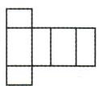
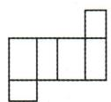
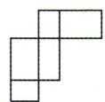
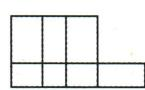
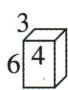
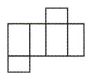
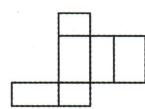

<!-- question-source:start -->
6 核心素养 空间观念 [较难] (1) 如图(1)所示的长方体, 长、宽、高分别为 4,3,6. 若将它的表面沿某几条棱剪开, 展成一个平面图形, 则①\~④中, 可能是该长方体展开图的有\_\_\_\_(填序号).

  
①

  
②

  
③

  
④

(2) 图(2)、图(3)分别是(1)中长方体的两种展开图, 求得图(2)的外围周长为52, 请你求出图(3)的外围周长.
(3)(1)中长方体的展开图还有其他形式,请你画出一个使外围周长最大的展开图,并求出这个外围周长.

  
图(1)  
图(2)

  
图(3)

电子错题本鸭
<!-- question-source:end -->
