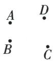

<!-- question-source:start -->
5 如图, A, B, C, D 四点在同一平面内, 并且每三点都不在同一条直线上, 读下列语句, 按要求画出图形.

(1) 连接 AD, 并延长线段 DA;
(2) 连接 BC, 并反向延长线段 BC;
(3) 连接 AC, BD 相交于点 O;

(4) $DA$ 的延长线与 $BC$ 的反向延长线交于点 $P$ .

<!-- question-source:end -->

![[Q00097320A1]]
