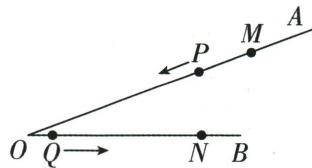

<!-- question-source:start -->
5 思想方法 数形结合 [2025 云南曲靖期末, 中] 如图, $\angle AOB$ 的边 $OA$ 上有一动点 $P$ , 从距离 $O$ 点 $24 \mathrm{~cm}$ 的点 $M$ 处出发, 沿线段 $MO$ , 射线 $OB$ 运动, 点 $P$ 在线段 $MO$ (包含点 $O$ ) 上运动的速度为 $4 \mathrm{~cm} / \mathrm{s}$ , 在射线 $OB$ (不包含点 $O$ ) 上运动的速度为 $5 \mathrm{~cm} / \mathrm{s}$ ; 动点 $Q$ 从点 $O$ 出发, 沿射线 $OB$ 运动, 速度为 $2 \mathrm{~cm} / \mathrm{s}$ . $P, Q$ 两点同时出发, 设运动时间是 $t \mathrm{~s}$ .

(1) 当点 P 在线段 MO 上运动时, t 为何值, 能使 OP = OQ?

(2) 若点 Q 运动到距离 O 点 18 cm 的点 N 处停止, 在点 Q 停止运动前, 点 P 能否追上点 Q? 如果能, 求出 t 的值; 如果不能, 请说出理由.

(3) 若 $P, Q$ 两点不停止运动, $t$ 为何值时, 它们相距 $14 \mathrm{~cm}$ ? (若点 $P$ 在线段 $MO$ 上, 点 $Q$ 在射线 $OB$ 上, 则 $P, Q$ 两点的距离为点 $P$ 到点 $O$ 的距离与点 $Q$ 到点 $O$ 的距离之和)

<!-- source-part:3 pages:101-121 -->
<!-- question-source:end -->

![[Q00099431A1]]
