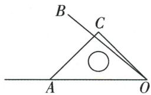
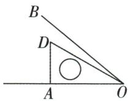

<!-- question-source:start -->
2[2025 山西大同质检]如图(1)、图(2)所示,把两个三角板先后放在 $\angle AOB$ 上, $\angle AOC=45^{\circ}$ , $\angle AOD=30^{\circ}$ ,则 $\angle AOB$ 的度数可能是()

图(1) 图(2)
A. $60^{\circ}$ B. $50^{\circ}$ C. $40^{\circ}$ D. $30^{\circ}$
<!-- question-source:end -->

![[Q00100759A1]]
