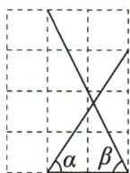
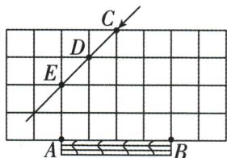

<!-- question-source:start -->
3 如图所示,正方形网格中有 $\angle\alpha$ 和 $\angle\beta$ , 如果每个小正方形的边长都为 1, 则 $\angle\alpha$ 与 $\angle\beta$ 的大小关系为
A. $\angle\alpha<\angle\beta$ B. $\angle\alpha=\angle\beta$ C. $\angle\alpha>\angle\beta$ D. 无法估测

建议用时 20 分钟 答案 D61

(第3题图)

(第4题图)
<!-- question-source:end -->

![[Q00100760A1]]
