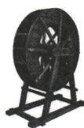
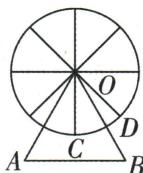

<!-- question-source:start -->
7[2024 辽宁沈阳期末]图(1)中的水车是一种古老的灌溉工具, 图(2)是它的示意图, 水车的主体的纵截面是一个圆形, 且被等分成了8份, 三角形OAB是水车的支架, $\angle AOB = 60^{\circ}$ . 水车的支架固定不动, 水车的主体可绕着圆心O旋转. (1)求 $\angle COD$ 的度数; (2)在图(2)中, 若OC平分 $\angle AOB$ , 求 $\angle BOD$ 的度数; (3)在水车的旋转过程中, 当 $\angle AOB$ 与 $\angle COD$ 有重合部分时, 设 $\angle BOD$ 的度数为 $x^{\circ}$ , 直接写出 $\angle AOC$ 的度数(用含x的代数式表示).

图(1)

图(2)
<!-- question-source:end -->

![[Q00100774A1]]
