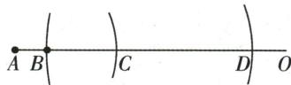

> [!success]- 必刷题
>
> > [!success] **【答案】** 详见解析
>
> > [!note]- **【解析】**
> > 【解】(不用写作法,画出符合要求的图即可)先作射线AO,以A为圆心,线段a的长为半径画弧交射线AO于C,再以C为圆心,线段b的长为半径画弧交射线CO于D,最后以D为圆心,线段c的长为半径画弧交线段AD于B,如图,线段AB即为所求.
> >
> > 
