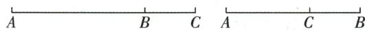

> [!success]- 必刷题
>
> > [!success] **【答案】** C
>
> > [!note]- **【解析】**
> > - **①**：如图(1), 点 $C$ 在线段 $AB$ 的延长线上时, 因为 $AB = 5 \mathrm{~cm}, BC = 2 \mathrm{~cm}$ , 所以 $AC = AB + BC = 5 + 2 = 7 (\mathrm{~cm})$ ;
> >
> > 
> > 图(1)
> > 图(2)
> > - **②**：如图(2)，点 C 在线段 AB 上时，因为 AB = 5 cm, BC = 2 cm，所以 AC = AB - BC = 5 - 2 = 3 (cm). 综上所述，AC 的长是 3 cm 或 7 cm.
> >
> > 故选 **C**.
