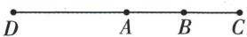

> [!success]- 必刷题
>
> > [!success] **【答案】** $\frac{2}{3}$
>
> > [!note]- **【解析】**
> > 如下图所示：
> > D A B C
> >
> > 
> >
> > 设 AB=1，则 DA=2, AC=2，所以 DB=3，所以线段 AC 是线段 DB 的 $\frac{2}{3}$ . 故答案为 $\frac{2}{3}$ .
