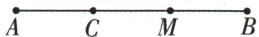

> [!success]- 必刷题
>
> > [!success] **【答案】** 8 cm
>
> > [!note]- **【解析】**
> > 如图, 因为点 C 在线段 AB 上, 且 $AC = \frac{1}{3}AB = 4 \, cm$ , 所以 BC = AB - AC = 8 cm. 因为 M 为 BC 的中点, 所以 $CM = \frac{1}{2}BC = 4 \, cm$ , 所以 $AM = AC + CM = 8 \, cm$ . 故答案为 8 cm.
> >
> > 
