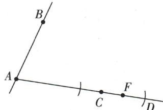

> [!success]- 必刷题
>
> > [!success] **【答案】** 详见解析
>
> > [!note]- **【解析】**
> > 【解】(1)如图,直线AB,射线AC即为所求.
> > (2)如图,线段AD即为所求.
> > (3) 如图, 因为 $AB = 3 \, cm, AD = 2AB$ , 所以 $AD = 2 \times 3 = 6 \, (\text{cm})$ . 因为 AC = 4 cm, 所以 CD =
> >
> > $AD - AC = 6 - 4 = 2(\mathrm{cm})$ .因为 $F$ 是线段 $CD$ 的中点，所以 $CF = \frac{1}{2} CD = \frac{1}{2}\times 2 = 1(\mathrm{cm})$ ，所以 $AF = AC + CF = 4 + 1 = 5(\mathrm{cm}).$
> >
> > 
