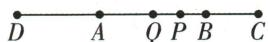

> [!success]- 必刷题
>
> > [!success] **【答案】** 详见解析
>
> > [!note]- **【解析】**
> > 【解】(1)因为AB=4,所以 $BC=\frac{1}{2}AB=2$ ,所以 $AC=AB+BC=4+2=6$ ,所以 $AD=\frac{1}{2}AC=3$ ,所以 $CD=AD+AC=3+6=9$ ,故线段CD的长为9.
> > (2) 因为 Q 为 AB 的中点, 所以 $BQ = \frac{1}{2}AB = \frac{1}{2} \times 4 = 2$ . 因为 $BP = \frac{1}{2}BC, BC = 2$ , 所以 BP = $\frac{1}{2} \times 2 = 1$ . 由题意分以下 2 种情况:
> > - **①**：如图(1), 当点 P 在点 B 左侧时, PQ = BQ - BP = 2 - 1 = 1;
> >
> > (2) 先计算点 Q 从点 O 运动到点 N 所用的时间, 然后求出点 P 从点 O 运动到点 N 所用的时间, 再进行比较即可得出结论.
> >
> > 
> >
> > (3) 分情况讨论: ① 当 P 在线段 OM 上, Q 在射线 OB 上时, 它们相距 14 cm;
> > - **②**：当 P, Q 均在射线 OB 上时, 它们相距 14 cm, 分情况构建关于 t 的方程, 求解即可.
> >
> > 图(1)
> > - **②**：如图(2)，当点 P 在点 B 右侧时， $PQ = BQ + BP = 2 + 1 = 3$ .
> >
> > 
> > 图(2)
> >
> > 综上,线段 PQ 的长为 1 或 3.
> >
> > ## 刷素养·
