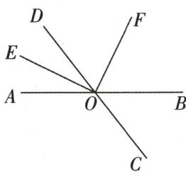
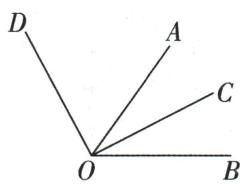

<!-- question-source:start -->
2[2025 江苏南通校级期末]如图, 直线 AB, CD 相交于点 O, OE 平分 $\angle AOD$ , OF 平分 $\angle BOD$ . 当直线 CD 绕点 O 顺时针旋转 $\alpha(0^{\circ}<\alpha<180^{\circ})$ 时, 下列各角的度数与 $\angle BOD$ 的度数变化无关的角是
A. $\angle AOD$ B. $\angle AOC$ C. $\angle EOF$ D. $\angle DOF$

  
(第2题图)

  
(第3题图)
<!-- question-source:end -->
