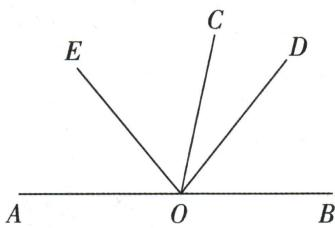

<!-- question-source:start -->
4[2024 四川成都期末]如图, 点 A, O, B 在同一直线上, $\angle BOC = 78^{\circ}$ , $\angle DOE = 77^{\circ}$ , OD 是 $\angle BOC$ 的一条靠近 OC 边的三等分线.

(1) 求 $\angle COE$ 的度数;

(2) $OE$ 是 $\angle AOC$ 的平分线吗？说明你的理由.

<!-- question-source:end -->
