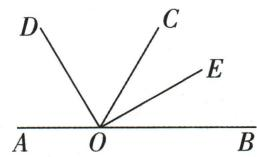

<!-- question-source:start -->
8[2025 辽宁抚顺期末]如图, 点 O 在直线 AB 上, 从点 O 引出射线 OC, 其中射线 OD 平分 $\angle AOC$ , 射线 OE 平分 $\angle BOC$ , 下列结论:
① $\angle DOE = 90^{\circ}$ ;
② $\angle COE$ 与 $\angle AOE$ 互补；
③若 OC 平分 $\angle BOD$ ，则 $\angle AOE = 150^{\circ}$ ;
④ $\angle BOE$ 的余角可表示为 $\frac{1}{2}(\angle AOE - \angle BOE)$ .
其中正确的是\_\_\_\_。(填序号)

建议用时-30分钟 答案-D64
<!-- question-source:end -->
