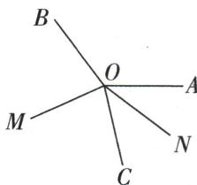

<!-- question-source:start -->
4[2024 陕西西安碑林区校级期末, 中] 如图, $\angle AOB = 126^{\circ}$ , 射线 $OC$ 在 $\angle AOB$ 外, 且 $\angle BOC = 2\angle AOC$ , 若 $OM$ 平分 $\angle BOC$ , $ON$ 平分 $\angle AOC$ , 则 $\angle MON =$ \_\_\_\_.

<!-- question-source:end -->
