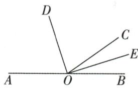

<!-- question-source:start -->
10[2024 江苏南京中考]如图, 点 A, O, B 在同一条直线上, OD 是 $\angle AOC$ 的平分线, OE 是 $\angle BOC$ 的平分线. 若 $\angle AOE = 162^{\circ}$ , 则 $\angle BOD =$ \_\_\_\_ $^{\circ}$ .

<!-- question-source:end -->
