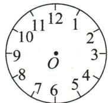
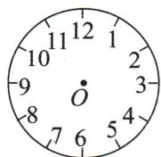
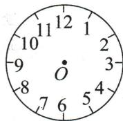
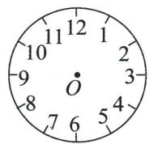
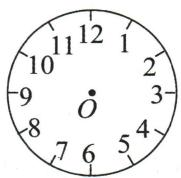

<!-- question-source:start -->
7 核心素养运算能力 [难] 如图, 在圆形钟面上, 点 O 为钟面的圆心, 以点 O 为顶点按要求画出符合下列要求的角(角的两边不经过钟面上的数字):

(1) 在图(1)中画一个锐角, 使锐角的内部含有2个数字, 且数字之差的绝对值最大;

(2)在图(2)中画一个直角,使直角的内部含有3个数字,且所含3个数字之积等于这3个数字之和;

(3) 在图(3)中画一个钝角, 使钝角的内部含有4个数字, 且数字之和最小;

(4) 在图(4)中画一个平角, 使平角的内部与外部的数字之和相等;

(5)在图(5)中画两个直角,使这两个直角的内部含有的3个数字之和相等.(画出一种即可)

图(1)

图(3)

图(2)

图(4)

图(5)
<!-- question-source:end -->

![[Q00097778A1]]
