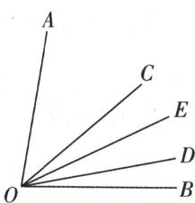
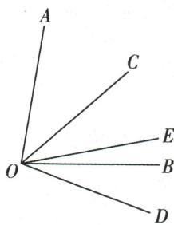

> [!success]- 必刷题
>
> > [!success] **【答案】** A
>
> > [!note]- **【解析】**
> > 如图(1)，当 $OD$ 在 $OB$ 上方时，因为 $\angle AOB = \alpha, OC$ 是 $\angle AOB$ 的平分线，所以 $\angle BOC = \frac{1}{2}\alpha.$ 因为 $\angle BOD = \frac{1}{3}\angle COD,$ $\angle BOD + \angle COD = \angle BOC = \frac{1}{2}\alpha,$ 所以 $\angle BOD = \frac{1}{8}\alpha,$ 则 $\angle COD = \frac{3}{8}\alpha.$ 因为 $OE$ 平分 $\angle COD$ ，所以 $\angle DOE = \frac{1}{2}\angle COD = \frac{3}{16}\alpha,$ 所以 $\angle BOE = \angle DOE + \angle BOD = \frac{3}{16}\alpha +\frac{1}{8}\alpha = \frac{5}{16}\alpha .$
> >
> > 
> >
> >   
> > 图(1)  
> > 图(2)
> >
> > 如图(2)，当 $OD$ 在 $OB$ 下方时，因为 $\angle AOB = \alpha, OC$ 是 $\angle AOB$ 的平分线，所以 $\angle BOC = \frac{1}{2}\alpha.$ 因为 $\angle BOD = \frac{1}{3} \angle COD$ ，所以 $\angle BOD = \frac{1}{2} \angle BOC = \frac{1}{4}\alpha$ ，所以 $\angle COD = \frac{3}{4}\alpha.$ 因为 $OE$ 平分 $\angle COD$ ，所以 $\angle DOE = \frac{1}{2} \angle COD = \frac{3}{8}\alpha$ ，所以
> >
> > ## 易错警示
> >
> > (2)②注意分当射线 OF 在 $\angle EOB$ 内部和外部两种情况讨论, 不要漏解.
> >
> > $\angle BOE = \angle DOE - \angle BOD = \frac{3}{8}\alpha -\frac{1}{4}\alpha = \frac{1}{8}\alpha .$ 综上所述， $\angle BOE = \frac{5}{16}\alpha$ 或 $\frac{1}{8}\alpha .$
> >
> > 故选 **A**.
