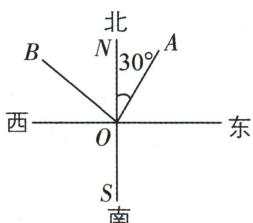
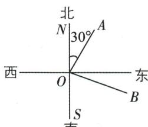

> [!success]- 必刷题
>
> > [!success] **【答案】** 北偏西 $50^{\circ}$ 或南偏东 $70^{\circ}$
>
> > [!note]- **【解析】**
> > 设南北方向的直线为 NS. 如图(1)，因为 $\angle NOA = 30^{\circ}$ ， $\angle AOB = 80^{\circ}$ ，所以 $\angle NOB = \angle AOB - \angle NOA = 80^{\circ} - 30^{\circ} = 50^{\circ}$ ，所以射线 OB 的方向是北偏西 $50^{\circ}$ ；如图(2)， $\angle SOB = 180^{\circ} - 30^{\circ} - 80^{\circ} = 70^{\circ}$ ，所以射线 OB 的方向是南偏东 $70^{\circ}$ 。故答案为北偏西 $50^{\circ}$ 或南偏东 $70^{\circ}$ 。
> >
> > 
> > 图(1)
> >
> > 
> > 图(2)
> >
> > 方法总结
> > 我们常用“四面八方”来说明各个方向，即东、南、西、北、东南、西南、西北、东北，但事实上仅有这八个方向是不够的，通常以正北或正南方向为基准，配以偏东或偏西的角度来表示.
> >
> > ## 刷素养
