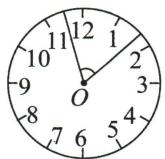
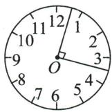
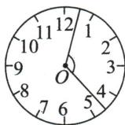
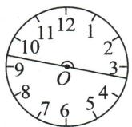
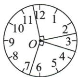

> [!success]- 必刷题
>
> > [!success] **【答案】** 详见解析
>
> > [!note]- **【解析】**
> > 【解】(1)\~(4)如图(1)\~图(4)所示.
> >
> > (5)如图(5)所示,答案不唯一.
> >
> > 
> > 图(1)
> >
> > 
> > 图(2)
> >
> > 
> >
> > 
> > 图(4)
> >
> > 图(3)
> > 
> > 图(5)
