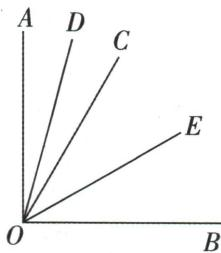

<!-- question-source:start -->
12[2025 浙江嘉兴期末]如图, $\angle AOB$ 是一个直角, 在 $\angle AOB$ 内部作射线 $OC$ , 再分别作 $\angle AOC$ 和 $\angle BOC$ 的平分线 $OD$ 和 $OE$ .

(1)【尝试】若 $\angle BOC = 60^{\circ}$ , 则 $\angle DOE$ 的度数是 $\underline{\hspace{3cm}}$ .

(2)【猜想】若射线 $OC$ 在 $\angle AOB$ 内部绕 $O$ 点旋转, 则 $\angle DOE$ 的度数是 $\underline{\hspace{3cm}}$ .

(3)【验证】请给出 (2) 中你的猜想成立的理由.

<!-- question-source:end -->

![[Q00097838A1]]
