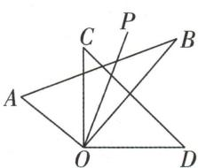
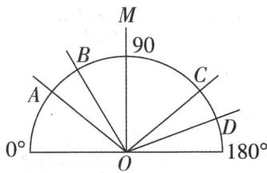

<!-- question-source:start -->
9 如图, 将一副三角尺的直角顶点 O 重合在一起. 若 $\angle COB$ 与 $\angle DOA$ 的度数比是 2:7, OP 平分 $\angle DOA$ , 则 $\angle POC =$ \_\_\_\_ $^{\circ}$ .

(第9题图)

(第 10 题图)
<!-- question-source:end -->

![[Q00099293A1]]
