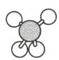
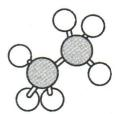
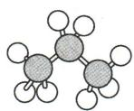
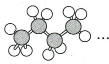

<!-- question-source:start -->
5[2024 重庆中考 A 卷]烷烃是一类由碳、氢元素组成的有机化合物质,如图是这类物质前四种化合物的分子结构模型图,其中灰球代表碳原子,白球代表氢原子.第1种如图①有4个氢原子,第2种如图②有6个氢原子,第3种如图③有8个氢原子,……按照这一规律,第10种化合物的分子结构模型中氢原子的个数是（）

①

②

③

④

A. 20 B. 22 C. 24 D. 26
<!-- question-source:end -->

![[Q00099303A1]]
