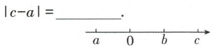

<!-- question-source:start -->
11[2025 河南南阳期末]有理数 a, b, c 在数轴上的位置如图所示, 化简: $\left|a - b\right| + \left|b - c\right| - \left|c - a\right| =$ \_\_\_\_.

<!-- question-source:end -->

![[Q00099321A1]]
