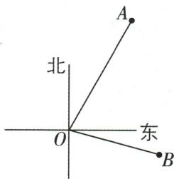
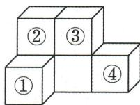

<!-- question-source:start -->
5[2024 天津西青区期末]如图,某轮船在点 O 处测得灯塔 A 位于北偏东 $30^{\circ}40'$ 方向上,测得灯塔 B 位于南偏东 $75^{\circ}$ 方向上,则 $\angle AOB$ 的度数为 （ ）
A. $74^{\circ}20'$ B. $75^{\circ}20'$ C. $75^{\circ}40'$ D. $85^{\circ}20'$

(第5题图)
(第7题图)
<!-- question-source:end -->

![[Q00100836A1]]
