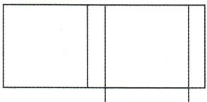
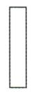
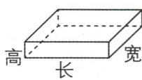

<!-- question-source:start -->
13[2024 山西阳泉期末]小明在学习了正方体的展开图后,明白了很多几何体都能展开成平面图形.于是他在家用剪刀剪开了一个长方体纸盒,可是一不小心多剪开了一条棱,把纸盒剪成了两部分,如图(1)、图(2)所示.请根据你所学的知识,回答下列问题:
(1)观察判断:小明共剪开了\_\_\_\_条棱;
(2)动手操作:现在小明想将剪断的图(2)重新粘贴到图(1)上去,而且经过折叠以后,仍然可以还原成一个长方体纸盒(如图(3)),请你帮助小明在图(1)中补全图形;(画出一种即可)

(3)解决问题:经过测量,小明发现这个纸盒的底面是一个正方形,其边长是长方体的高的5倍,并且纸盒所有棱长的和是880 cm,求这个纸盒的体积.

图(1)

图(2)

图(3)
<!-- question-source:end -->

![[Q00101927A1]]
