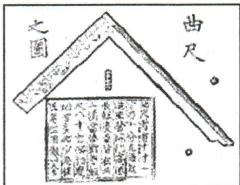
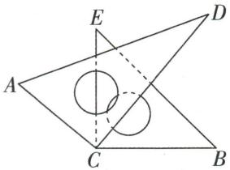

<!-- question-source:start -->
11[2024 辽宁盘锦期末]

<table><tr><td>课题题目</td><td>三角尺中的数学</td></tr><tr><td>背景材料</td><td>如图,鲁班发明的曲尺,能正确画出直角,用于告知工匠哪些尺寸是不规则的,哪些尺寸是规则的</td></tr><tr><td>任务1</td><td>如图,将两块直角三角尺的直角顶点C叠放在一起.若∠DCE=40°,求∠ACB的度数</td></tr><tr><td>任务2</td><td>猜想:∠ACB与∠DCE有怎样的数量关系,并说明理由</td></tr></table>
<!-- question-source:end -->

![[Q00101939A1]]
