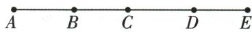

<!-- question-source:start -->
8[2025 河南郑州校级期末]如图, AE 是一段高铁行驶路线图, 图中字母表示的 5 个点表示高铁经停的 5 个车站, 若高铁在这段路线上往返行车, 则需印制的车票有 ( )
A. 10 种 B. 11 种 C. 20 种 D. 22 种

<!-- question-source:end -->

![[Q00101948A1]]
