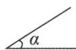
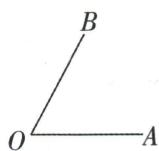

<!-- question-source:start -->
17[2024 安徽滁州期末]已知 $\angle\alpha,\angle AOB$ (如图). (1)以 $OB$ 为一边,作 $\angle BOC=\angle\alpha$ . (要求:仅用直尺和圆规作图,不写作法,保留作图痕迹) (2)在(1)的条件下,若 $\angle AOB=60^{\circ},\angle\alpha=20^{\circ}$ ,则 $\angle AOC$ 的度数为\_\_\_\_.

<!-- question-source:end -->

![[Q00101957A1]]
