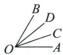
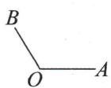
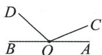
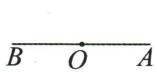

<!-- question-source:start -->

## 19【阅读理解】

图(1)

图(2)

备用图

图(3)

【知识运用】

②当 t 的值为多少时, 射线 OC, OD, OA 中恰好有一条射线是其余两条射线中任意一条射线的伴随线?

①是否存在某个时刻,使得 $\angle COD$ 的度数是 $20^{\circ}$ ?若存在,求出t的值;若不存在,请说明理由.

(1)如图(2)，若 $\angle AOB=120^{\circ}$ ，射线 $OM$ 是射线 $OA$ 的伴随线，则 $\angle AOM=$ \_\_\_\_°；若 $\angle AOB$ 的度数是 $\alpha$ ，射线 $ON$ 是射线 $OB$ 的伴随线，射线 $OC$ 是 $\angle AOB$ 的平分线，则 $\angle NOC$ 的度数是\_\_\_\_（用含 $\alpha$ 的代数式表示）.

(2)如图(3)，若 $\angle AOB=180^{\circ}$ ，射线 $OC$ 与射线 $OA$ 重合，并绕点 $O$ 以每秒 $3^{\circ}$ 的速度逆时针转动，同时射线 $OD$ 与射线 $OB$ 重合，并绕点 $O$ 以每秒 $5^{\circ}$ 的速度顺时针转动，当射线 $OD$ 与射线 $OA$ 重合时，射线 $OD,OC$ 均停止转动.设射线 $OD$ 的转动时间为 $t$ 秒.

图书增值
<!-- question-source:end -->

![[Q00102025A1]]
