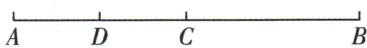
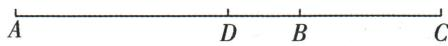

> [!success]- 必刷题
>
> > [!success] **【答案】** C
>
> > [!note]- **【解析】**
> > 根据题意分两种情况: ①如图(1), 因为 AB=4, BC=2, 所以 AC=AB-BC=2. 因为 D 是线段 AC 的中点, 所以 $AD=\frac{1}{2}AC=\frac{1}{2}\times2=1$ .
> >
> > 
> > 图(1)
> > - **②**：如图(2)，因为 AB=4, BC=2，所以 AC=AB+BC=6。因为 D 是线段 AC 的中点，所以 $AD=\frac{1}{2}AC=\frac{1}{2}\times6=3$ 。所以线段 AD 的长为 1 或 3。故选 C。
> >
> > 
> > 图(2)
