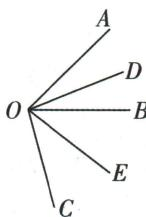
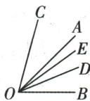

> [!success]- 必刷题
>
> > [!success] **【答案】** $60^{\circ}$ 或 $15^{\circ}$
>
> > [!note]- **【解析】**
> > - **①**：当∠AOB在∠B 如图(1).
> > 因为 $\angle AOB=45^{\circ}$ ,
> > OD 平分 $\angle AOB$ ,
> > 所以 $\angle BOD=22.5^{\circ}$ .
> > 因为 $\angle BOC=75^{\circ}$ ,
> > OE 平分 $\angle BOC$ ,
> > 所以 $\angle BOE=37.5^{\circ}$ ,
> > 所以 $\angle DOE=22.5^{\circ}+37.5^{\circ}=60^{\circ}$ .
> > - **②**：当 $\angle AOB$ 在 $\angle BOC$ 内部时，如图 (2). 因为 $\angle AOB=45^{\circ}$ , OD 平分 $\angle AOB$ , 所以 $\angle BOD=22.5^{\circ}$ .
> > 因为 $\angle BOC=75^{\circ}$ , OE 平分 $\angle BOC$ ,
> > 所以 $\angle BOE=37.5^{\circ}$ ,
> > 所以 $\angle DOE=37.5^{\circ}-22.5^{\circ}=15^{\circ}$ .
> > 故答案为 $60^{\circ}$ 或 $15^{\circ}$ .
> >
> > 
> > 图(1)
> >
> > 
> > 图(2)
