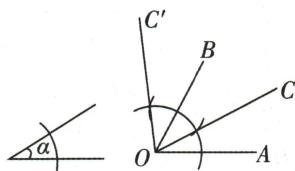

> [!success]- 必刷题
>
> > [!success] **【答案】** $40^{\circ}$ 或 $80^{\circ}$
>
> > [!note]- **【解析】**
> > 【解】(1)如图, $\angle BOC,\angle BOC'$ 即为所求.
> >
> > 
> >
> > (2) 因为 $\angle AOB = 60^{\circ}$ , $\angle BOC = \angle BOC' = 20^{\circ}$ , 所以 $\angle AOC = \angle AOB - \angle BOC = 40^{\circ}$ , $\angle AOC' = \angle AOB + \angle BOC' = 80^{\circ}$ . 故答案为 $40^{\circ}$ 或 $80^{\circ}$ .
