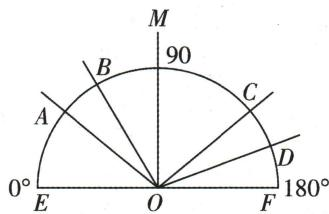

> [!success]- 必刷题
>
> > [!success] **【答案】** ①③
>
> > [!note]- **【解析】**
> > 因为 $\angle AOB = \angle COD$ ，所以 $\angle AOB + \angle BOC = \angle COD + \angle BOC$ ，所以 $\angle AOC = \angle BOD$ ，故 ① 正确。由题意可得 $\angle AOB = 60^\circ - 40^\circ = 20^\circ = \angle COD$ 。因为 $\angle AOC + \angle BOC = 180^\circ$ ，所以 $\angle AOB + \angle BOC + \angle BOC = 180^\circ$ ，即 $20^\circ + \angle BOC + \angle BOC = 180^\circ$ ，所以 $\angle BOC = 80^\circ$ ，所以 $60^\circ + 80^\circ + 20^\circ = 160^\circ$ ，即射线 $OD$ 经过刻度线 160，故 ② 错误。如图，因为 $\angle COD = \angle AOB = 20^\circ$ ，所以 $\angle MOC = 3\angle COD = 60^\circ$ 。因为射线 $OM$ 经过刻度线 90，所以 $\angle EOM = \angle FOM = 90^\circ$ ，所以 $\angle MOB = 90^\circ - 60^\circ = 30^\circ$ ，所以 $\angle BOC = \angle MOC + \angle MOB = 90^\circ$ ，所以 $\angle MOB$ 和 $\angle MOC$ ， $\angle BOE$ 和 $\angle COF$ 互为余角。又因为 $\angle AOE$ 和 $\angle AOM$ ， $\angle BOE$ 和 $\angle BOM$ ， $\angle COM$ 和 $\angle COF$ ， $\angle DOM$ 和 $\angle DOF$ 互为余角，所以共有 6 对角互为余角，故 ③ 正确。所以正确的有 ①③，故答案为 ①③。
> >
> > 
