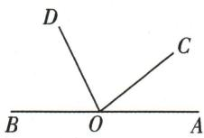
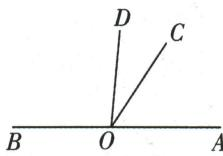
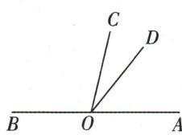
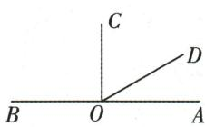

> [!success]- 必刷题
>
> > [!success] **【答案】** 详见解析
>
> > [!note]- **【解析】**
> > (1)40 $\frac{\alpha}{6}$
> >
> > (2)【解】当射线 $OD$ 与 $OA$ 重合时, $t = \frac{180}{5} = 36$ .
> > - **①**：存在. 当 $\angle COD$ 的度数是 $20^{\circ}$ 时, 有两种可能: 若在相遇之前, 则 $180 - 5t - 3t = 20$ , 所以 $t = 20$ ; 若在相遇之后, 则 $5t + 3t - 180 = 20$ , 所以 $t = 25$ . 综上所述, 当 $t = 20$ 或 25 时, $\angle COD$ 的度数是 $20^{\circ}$ .
> > - **②**：相遇之前: a. 如图(1), 当 $OC$ 是 $OA$ 的伴随线时, 则 $\angle AOC = \frac{1}{2} \angle COD$ , 即 $3t = \frac{1}{2}(180 - 5t - 3t)$ , 解得 $t = \frac{90}{7}$ .
> >
> > 
> >
> > 
> > 图(1)
> > 图(2)
> >
> > b. 如图(2)，当 OC 是 OD 的伴随线时，则 $\angle COD = \frac{1}{2} \angle AOC$ ,
> > 即 $180-5t-3t=\frac{1}{2}\times3t$ ，解得 $t=\frac{360}{19}$ .
> > 相遇之后：
> > c. 如图(3)，当 OD 是 OC 的伴随线时，则 $\angle COD = \frac{1}{2} \angle AOD$ ，即 $5t + 3t - 180 = \frac{1}{2}(180 - 5t)$ ，解得 $t = \frac{180}{7}$ .
> >
> > 
> > 图(3)
> >
> > 
> > 图(4)
> >
> > d. 如图(4)，当 $OD$ 是 $OA$ 的伴随线时，则 $\angle AOD = \frac{1}{2}\angle COD,$ 即 $180 - 5t = \frac{1}{2} (3t + 5t - 180)$ ，解得 $t = 30.$ 综上所述，当 $t = \frac{90}{7}$ 或 $\frac{360}{19}$ 或 $\frac{180}{7}$ 或30时， $OC,OD,$ $OA$ 中恰好有一条射线是其余两条射线中任意一条射线的伴随线.
> >
> > 
> >
> > 其实人跟树是一样的
> > 越是向往高处的阳光
> > 它的根就越要伸向黑暗的地底
> > 所以那些黑夜里你默默刷的每一道题
> > 都是为了更快缩短与光的距离
> >
> > 您在使用本书时若有问题需要反馈，请及时与我们联系。经核实后，您发现的问题或所提的建议确实对优化本书内容有益，我们将为您提供相应奖励。
> >
> > 
