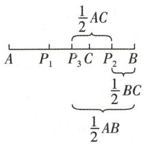

> [!success]- 必刷题
>
> > [!success] **【答案】** =
>
> > [!note]- **【解析】**
> > 【解】(1)①因为 AB=CD，
> > 所以 $AB+BC=CD+BC$ ，即 AC=BD。
> > 故答案为=。
> > - **②**：因为 $BC=\frac{3}{4}AC$ ，且 $AC=12\ cm$ ，
> > 所以 $BC=\frac{3}{4}\times12=9\ (cm)$ ，
> > 所以 AB=CD=AC-BC=12-9=3(cm)，
> > 所以 $AD=AC+CD=12+3=15\ (cm)$ .
> > 故答案为15.
> > (2) 设 AB = 3x cm, BC = 4x cm, CD = 5x cm,
> > 则 AD = 12x cm.
> > 因为点 M 是 AB 的中点，点 N 是 CD 的中点，
> > 所以 $AM = BM = \frac{3}{2}x \, cm, CN = DN = \frac{5}{2}x \, cm.$ 又因为 MN=16 cm，
> > 所以 $\frac{3}{2}x + 4x + \frac{5}{2}x = 16$ 解得 x=2，所以 AD=24 cm.
> >
> > ## 思路分析
> >
> > (1) 由中点的定义得 $CM = \frac{1}{2} AC, CN = \frac{1}{2} BC$ , 根据 $MN = CM + CN = \frac{1}{2} AC + \frac{1}{2} BC = \frac{1}{2}(AC + BC)$ 可得答案.
> >
> > 易错警示设运动时间为t s, 分别表示出 OP 和 OQ 的长, 再结合 OP = OQ 列出方程, 求出 t 的值即可解答, 注意要分情况讨论, 不要漏解.
> >
> > ## 大招解读|三中点模型
> >
> > <table><tr><td></td><td></td></tr><tr><td colspan="2">条件:点C是线段AB上任意一点,点P1,P2,P3分别是线段AC,BC,AB的中点.结论:P1P2=1/2AB=AP3=P3B,P2P3=1/2AC=AP1=CP1</td></tr></table>
