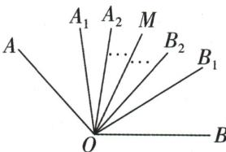

<!-- question-source:start -->
1 [2024 河北唐山期中, 中] 如图, $\angle AOB = \alpha$ , $OA_{1}, OB_{1}$ 分别是 $\angle AOM$ 和 $\angle MOB$ 的平分线,

$OA_{2},OB_{2}$ 分别是 $\angle A_1OM$ 和 $\angle MOB_{1}$ 的平分线， $OA_{3},OB_{3}$ 分别是 $\angle A_2OM$ 和 $\angle MOB_{2}$ 的平分线， $\cdots,OA_n,OB_n$ 分别是 $\angle A_{n-1}OM$ 和 $\angle MOB_{n-1}$ 的平分线，则 $\angle A_nOB_n$ 的度数是（）A. $\frac{\alpha}{n}$ B. $\frac{\alpha}{2^{n-1}}$ C. $\frac{\alpha}{2^n}$ D. $\frac{\alpha}{n^2}$
<!-- question-source:end -->

![[Q00101896A1]]
