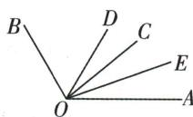
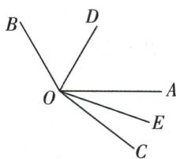

> [!success]- 必刷题
>
> > [!success] **【答案】** B
>
> > [!note]- **【解析】**
> > 【解】(1) 因为 $\angle AOB = 120^{\circ}$ , $OD$ 平分 $\angle AOB$ , 所以 $\angle AOD = \angle BOD = \frac{1}{2} \angle AOB = 60^{\circ}$ . 因为 $OE$ 平分 $\angle AOC$ , $\angle AOC = 40^{\circ}$ , 所以 $\angle AOE = \frac{1}{2} \angle AOC = 20^{\circ}$ , 所以 $\angle DOE = \angle AOD - \angle AOE = 60^{\circ} - 20^{\circ} = 40^{\circ}$ .
> >
> > (2) 若射线 $OC$ 在 $\angle AOB$ 的内部, 如图 (1). 因为 $\angle AOB = m^{\circ}, \angle AOC = n^{\circ}, OD, OE$ 分别平分 $\angle AOB, \angle AOC$ , 所以 $\angle DOE = \angle AOD - \angle AOE = \frac{1}{2} \angle AOB - \frac{1}{2} \angle AOC = \frac{1}{2}(m-n)^{\circ}$ .
> >
> > (2) 由于无法确定射线 OC 的位置, 所以需要分类讨论: 射线 OC 在 $\angle AOB$ 的内部和外部, 然后利用角平分线的性质求解.
> >
> > 
> > 图(1)
> >
> > 
> > 图(2)
> >
> > 若射线 OC 在 $\angle AOB$ 外部, 如图(2). 因为$\angle AOB = m^{\circ}, \angle AOC = n^{\circ}, OD, OE$ 分别平分 $\angle AOB, \angle AOC$ ，所以 $\angle DOE = \angle AOD + \angle AOE = \frac{1}{2} \angle AOB + \frac{1}{2} \angle AOC = \frac{1}{2}(m + n)^{\circ}$ 。综上， $\angle DOE$ 的度数为 $\frac{1}{2}(m - n)^{\circ}$ 或 $\frac{1}{2}(m + n)^{\circ}$ 。
