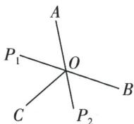

> [!success]- 必刷题
>
> > [!success] **【答案】** $150^{\circ}$
>
> > [!note]- **【解析】**
> > 【解】(1)因为 $\angle AOB=90^{\circ},\angle AOC=60^{\circ}$ , 所以 $\angle BOC=\angle AOB+\angle AOC=150^{\circ}$ , 故答案为 $150^{\circ}$ .
> >
> > (2)由(1)知 $\angle BOC=150^{\circ}$ . 因为 $OD$ 平分 $\angle BOC$ , 所以 $\angle DOC=\frac{1}{2}\angle BOC=75^{\circ}$ . 因为 $OE$ 平分 $\angle AOC,\angle AOC=60^{\circ}$ , 所以 $\angle COE=\frac{1}{2}\angle AOC=30^{\circ}$ , 所以 $\angle DOE=\angle DOC-\angle COE=45^{\circ}$ .
> >
> > (3)因为 $\angle AOB=90^{\circ},\angle AOC=2\alpha$ , 所以 $\angle BOC=\angle AOB+\angle AOC=90^{\circ}+2\alpha$ . 因为 $OD$ 平分 $\angle BOC$ , 所以 $\angle DOC=\frac{1}{2}\angle BOC=45^{\circ}+\alpha$ . 因为 $OE$ 平分 $\angle AOC,\angle AOC=2\alpha$ , 所以 $\angle COE=\frac{1}{2}\angle AOC=\alpha$ , 所以 $\angle DOE=\angle DOC-\angle COE=45^{\circ}$ .
> >
> > 大招解读 | 三个角围成周角
> > 条件:如图,已知 $\angle AOB+\angle BOC+\angle AOC=360^{\circ}$ , $OP_{1}$ 平分 $\angle AOC, OP_{2}$ 平分 $\angle BOC$ .
> >
> > 
> >
> > 结论: $\angle P_{1}OP_{2}=180^{\circ}-\frac{1}{2}\angle AOB.$
