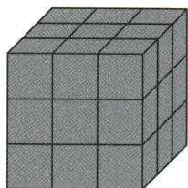

<!-- question-source:start -->
1[2025 山西太原质检]如图,将一个三阶魔方表面涂色,则会出现有的小正方体有一面涂色,有的小正方体有两面涂色,有的小正方体有三面涂色,有的小正方体各面都没有涂色的情况.观察并回答下列问题:

(1) 其中各面都没有涂色的小正方体有\_\_\_\_个,有一面涂色的小正方体有\_\_\_\_个,有两面涂色的小正方体有\_\_\_\_个,有三面涂色的小正方体有\_\_\_\_个;

(2)如果换成四阶魔方,则各面都没有涂色的小正方体有\_\_\_\_个,有三面涂色的小正方体有\_\_\_\_个;

(3) 如果是 $n (n \geqslant 2)$ 阶魔方, 则各面都没有涂色的小正方体有 \_\_\_\_ 个 (用含 n 的式子表示).
<!-- question-source:end -->

![[Q00099273A1]]
