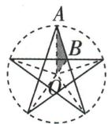
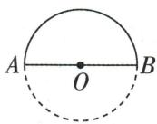
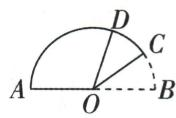
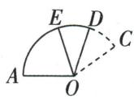
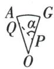
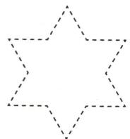
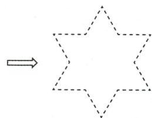

<!-- question-source:start -->
2[2025 福建福州期末]综合与实践

小乐在学习完绘制五角星后,对五角星的画法和剪法做了深入的研究:如图(1),由于五角星可由10个基本图形ABO组成,其他“n角福星”也有类似特征.受此启发,小乐尝试用一刀剪“n角福星”,具体操作如下:

如图(2)，将一张圆心为 O 的圆形纸片沿直径对折，折痕为 AB；如图(3)，取圆上合适的一点 C，将 OC 下方的部分沿 OC 对折，得到 OD；再将折叠后的部分继续沿 OD 对折，得到 OE（如图(4)）；…，重复此操作，使最后一次折叠的起始边与 OA 重合，最终得到的扇形如图(5)所示。在半径 OG 上取一点 P，并沿图中虚线 PQ 剪开, 得到纸片 OPQ, 设 $\angle QPG = \alpha$ . 例如, 当 $\angle BOC = 36^{\circ}, \alpha = 54^{\circ}$ 时, 纸片展开后的图形便是 “5 角福星”.

图(1)

图(3)

图(2)

图(4)

图(5)

(1) 设上述折叠操作的次数为 $m(m>3)$ ，测量得到如下数据：

<table><tr><td>折叠次数m</td><td>∠BOC的度数</td><td>α的度数</td><td>形状</td></tr><tr><td>4</td><td>36°</td><td>54°</td><td>5角福星</td></tr><tr><td>5</td><td>30°</td><td>60°</td><td>6角福星</td></tr><tr><td>6</td><td>1</td><td>2</td><td>7角福星</td></tr><tr><td>...</td><td>...</td><td>...</td><td>...</td></tr></table>

根据上表, ①②处的内容分别是\_\_\_\_, \_\_\_\_, m 与 $\alpha$ 的数量关系是\_\_\_\_（用含 m 的式子表示 $\alpha$ ）.

(2)在图形设计环节,小乐发现,“6角福星”每个顶角均为 $60^{\circ}$ ,可以分割成五块或者六块,并拼成一个等边三角形,请完成这个设计(画出一种即可).

(要求:用直尺在图(6)中画出分割线(线段),用数字①②…给分割出的每一块标注,然后借助图(7)将拼接成的等边三角形画好,并对应标注每一块)

图(6)

图(7)

电子错题本鸭

建议用时-20分钟 答案-D67
<!-- question-source:end -->

![[Q00101904A1]]
