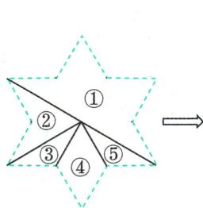
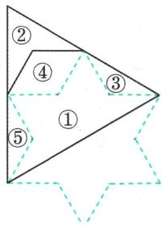

> [!success]- 必刷题
>
> > [!success] **【答案】** $$
>
> > [!note]- **【解析】**
> > 【解】(1)由题意得,取圆上合适的一点C,将OC下方的部分沿OC对折,折叠m次后,半圆被平分成 $(m+1)$ 份,每份圆心角大小都与 $\angle BOC$ 相等,所以 $\angle BOC=\frac{180^{\circ}}{m+1}$ .根据表格中数据可知, $\angle BOC$ 与 $\alpha$ 互余,所以当m=6时, $\angle BOC=\frac{180^{\circ}}{7},\alpha=90^{\circ}-\frac{180^{\circ}}{7}=\frac{450^{\circ}}{7}$ .故答案为
> >
> > $$
> > \frac {1 8 0 ^ {\circ}}{7}, \frac {4 5 0 ^ {\circ}}{7}, \alpha = 9 0 ^ {\circ} - \frac {1 8 0 ^ {\circ}}{m + 1}.
> > $$
> >
> > (2)如图(1)、图(2)所示.(答案不唯一)
> >
> > 
> >
> > 
> > 图(1)
> > 图(2)
