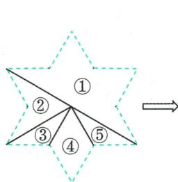
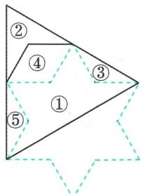

> [!success]- 必刷题
>
> > [!success] **【答案】** $$
>
> > [!note]- **【解析】**
> > 【解】(1)由题意得,取圆上合适的一点C,将OC下方的部分沿OC对折,折叠m次后,半圆被平分成 $(m+1)$ 份,每份圆心角大小都与 $\angle BOC$ 相等,所以 $\angle BOC=\frac{180^{\circ}}{m+1}$ .根据表格中数据可知, $\angle BOC$ 与 $\alpha$ 互余,所以当m=6时, $\angle BOC=\frac{180^{\circ}}{7},\alpha=90^{\circ}-\frac{180^{\circ}}{7}=\frac{450^{\circ}}{7}$ .故答案为
> >
> > $$
> > \frac {1 8 0 ^ {\circ}}{7}, \frac {4 5 0 ^ {\circ}}{7}, \alpha = 9 0 ^ {\circ} - \frac {1 8 0 ^ {\circ}}{m + 1}.
> > $$
> >
> > (2)如图(1)、图(2)所示.(答案不唯一)
> >
> > 
> >
> > 
> > 图(1)
> > 图(2)
> >
> > 综合与实践 设计学校田径运动会
> > 比赛场地
> > 
> >
> > ## 刷实践
> >
> > 【解】实施方案
> > 探究 1:400 米跑道中一段直道的长度为 (400-2×36×3.14)÷2=86.96(米).
> > 探究 2: 填表如下:
> >
> > <table><tr><td>跑道宽度x/米</td><td>0</td><td>1</td><td>2</td><td>3</td><td>4</td><td>5</td><td>...</td></tr><tr><td>跑道周长y/米</td><td>400</td><td>406.28</td><td>412.56</td><td>418.84</td><td>425.12</td><td>431.4</td><td>...</td></tr></table>
> >
> > $$
> > y = 2 \pi x + 4 0 0 = 6. 2 8 x + 4 0 0.
> > $$
> >
> > 当 $y = 446$ 时， $6.28x + 400 = 446$ ，解得 $x \approx 7.32$ . 因为 $7.32 \div 1.22 = 6$ ，所以最多能铺设道宽为 1.22 米的跑道 6 条.
> >
> > ## 全章综合训练
