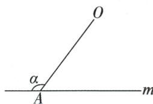

<!-- question-source:start -->
5[2025 河北张家口期末]如图, 直线 m 外有一定

点 O, A 是 m 上的一个动点, 当点 A 从左向右运动时, $\angle\alpha$ 的变化情况是 \_\_\_\_. (填“逐渐变大”)

“逐渐变小”“保持不变”或“无法确定”)
<!-- question-source:end -->

![[Q00097783A1]]
