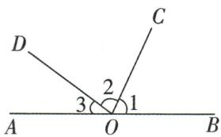
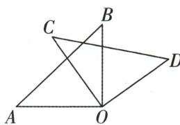

<!-- question-source:start -->
8 如图, 已知点 O 在直线 AB 上, $\angle1=65^{\circ}15'$ , $\angle2=78^{\circ}30'$ , 则 $\angle1+\angle2=$ \_\_\_\_ , $\angle3=$ \_\_\_\_.

(第8题图)

(第9题图)
<!-- question-source:end -->

![[Q00101874A1]]
