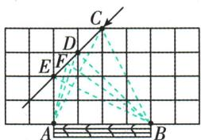
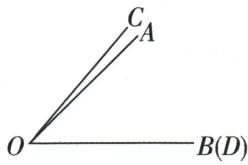

> [!success]- 必刷题
>
> > [!success] **【答案】** C
>
> > [!note]- **【解析】**
> > 如图, 连接 BC, AC, BD, AD, AE, BE, 在线段 DE 间任取一点 F, 连接 AF, BF, 通过测量可知 $\angle ACB < \angle ADB = \angle AEB < \angle AFB$ , 因而射门点在线段 DE (异于端点) 上一点时角最大. 故选 C.
> >
> > 
> >
> > 
> > (第4题图)
> > (第6题图)
