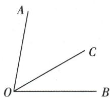
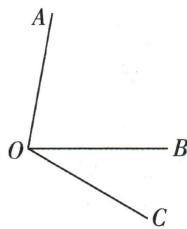

> [!success]- 必刷题
>
> > [!success] **【答案】** $50^{\circ}$ 或 $110^{\circ}$
>
> > [!note]- **【解析】**
> > 分为两种情况：……
> > - **①**：如图（1），当 OC 在 $\angle BOA$ 内部时， $\angle AOC = \angle AOB - \angle BOC = 80^{\circ} - 30^{\circ} = 50^{\circ}$ ;
> >
> > 
> >
> > 
> > 图(1)
> > 图(2)
> >
> > ## 易错警示
> >
> > 与描绘点的位置一样,题中有描绘射线的位置时,也应注意“无图有坑”,谨防漏解.
> > - **②**：如图（2），当 OC 在 $\angle BOA$ 外部时， $\angle AOC = \angle AOB + \angle BOC = 80^{\circ} + 30^{\circ} = 110^{\circ}$ .
> > 故答案为 $50^{\circ}$ 或 $110^{\circ}$ .
> >
> > ## 课时 2 角平分线
